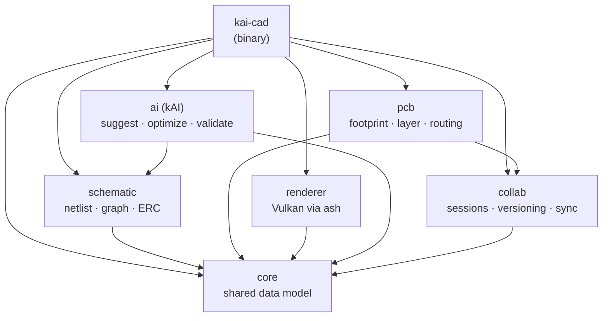
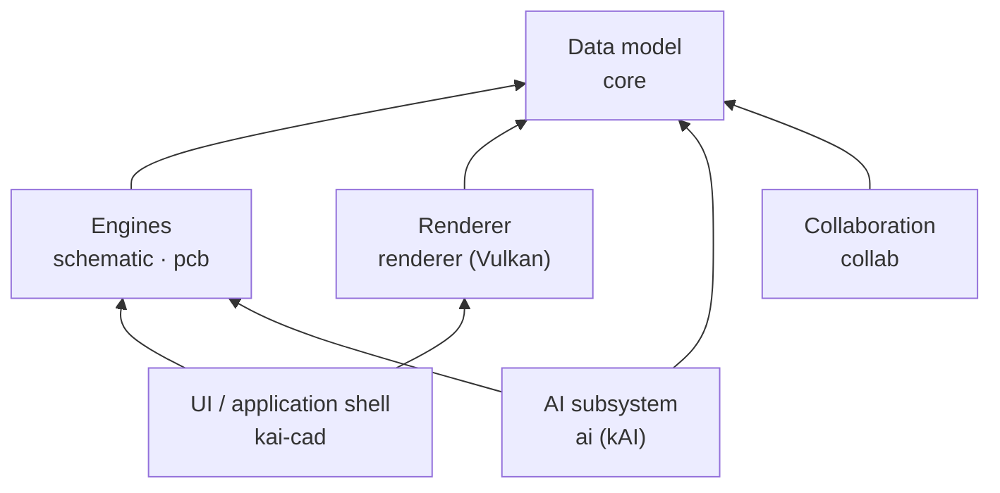
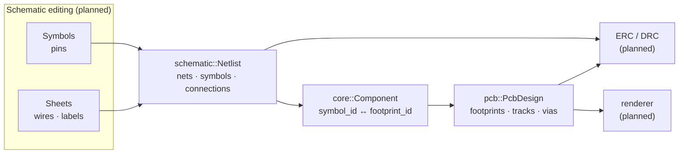

# KaiCad Architecture

> **Status: pre-alpha scaffold.** This document describes the intended
> architecture and the code that exists today. Most engines are type-level
> skeletons whose functions return `NotImplemented` or empty values. Do not
> read this as a description of working EDA functionality.

KaiCad is a Rust workspace containing a shared data model, per-domain engines,
a Vulkan renderer skeleton, an AI subsystem (`kAI`), a collaboration layer and
a thin application binary. The long-term goal is a complete EDA application
that is **not** a wrapper around KiCad (see `PRD.md`).

## Crate graph

Arrows mean "depends on". `core` sits at the bottom of the graph and must not
depend on any other workspace crate. The only cross-engine edge today is
`pcb -> collab` (declared in `pcb/Cargo.toml`; not yet used by `pcb` code).

## Application layering

The UI layer is currently only a CLI stub (`kai-cad/src/main.rs` prints version
information); a custom GUI is planned but not started. The AI and collaboration
layers are optional: KaiCad must remain usable without AI, network access or
external services (`PRD.md` §1.2, §1.3).

## What each crate owns

### `core` — shared data model

The single source of truth for design data. Dependencies: `serde`,
`serde_json`, `uuid`, `chrono`. No workspace dependencies.

| Type | Location | Purpose |
|------|----------|---------|
| `Project` | `core/src/lib.rs` | Root document: `id`, `name`, `version`, `schematic`, `pcb`, `metadata` |
| `SchematicData` | `core/src/lib.rs` | `sheets`, `symbols`, `nets` |
| `PcbData` | `core/src/lib.rs` | `outline`, `layers`, `stackup`, `footprints` |
| `ProjectMetadata` | `core/src/lib.rs` | Timestamps, author, description |
| `Symbol`, `Pin` | `core/src/symbol.rs` | Schematic symbol, pin type/position/direction |
| `Net`, `NetClass` | `core/src/net.rs` | Named connectivity and design-rule class |
| `Sheet`, `Wire`, `Label` | `core/src/sheet.rs` | Hierarchical sheets, wires, labels |
| `Component` | `core/src/component.rs` | Instance linking a symbol to a footprint |

All public types derive `serde::Serialize`/`Deserialize`. `PcbOutline`,
`PcbLayer`, `Stackup` and `core::pcb::Footprint` are empty placeholders.

### `schematic` — schematic engine

Dependencies: `core`, `petgraph`, `serde`, `uuid`. Modules:

- `netlist` — `Netlist`, `Connection`, `PinRef`; `generate_netlist()` is a stub
  that returns an empty netlist.
- `graph` — hand-rolled connectivity `Graph` of symbol/net `Node`s and `Edge`s.
  (`petgraph` is declared as a dependency but not used yet.)
- `erc` — `ERCResult`, `Violation`, `ViolationSeverity`; no rules implemented.

`Netlist` is currently defined twice: once at the crate root (`lib.rs`, used by
`generate_netlist`) and once in `netlist.rs`. Unifying them is future work.

### `pcb` — PCB engine

Dependencies: `core`, `collab`, `serde`, `uuid`, `chrono`. Modules:

- `footprint` — `Footprint`, `PadPosition`, `PadType`, `Outline`,
  `OutlineShape::{Rectangle, RoundedRectangle}`.
- `layer` — `LayerDefinition`, `LayerType`.
- `routing` — `Router`, `RoutingAlgorithm::{PushAndShove, LengthMatching,
  Hybrid}`, `OptimizationStrategy`.
- `lib.rs` — `PcbDesign` (`outline`, `layers`, `stackup`, `footprints`,
  `tracks`, `vias`), `Track`, `Via`, and a private `geometry::Point` type.

No routing algorithm or board geometry computation is implemented yet.

### `renderer` — Vulkan rendering engine

Dependencies: `core`, `ash` (Vulkan bindings), `serde`, `serde_json`, `uuid`.
Modules: `window`, `device`, `swapchain`, `render_pass`, `pipeline`.
`Renderer::new()` and `Renderer::render()` return
`Err(RendererError::NotImplemented)`. `ash` loads the Vulkan loader at runtime,
so the workspace builds on machines without a Vulkan SDK.

### `ai` — kAI subsystem

Dependencies: `core`, `schematic`, `serde`, `serde_json`, `uuid`. Modules:
`optimizer`, `suggester`, `validator`. Defines `kAIConfig`, `kAI`,
`OptimizationSuggestion`, `ChangeProposal`, `Constraint` and
`ValidationResult`. The default endpoint is `http://localhost:11434` (a local
model server) and `enable_deterministic_validation` defaults to `true`.
All entry points are stubs.

### `collab` — collaboration layer

Dependencies: `core`, `serde`, `serde_json`, `uuid`, `chrono`. Modules:
`versioning`, `sync`, `sharing`, `window`. Defines `CollabSession`,
`Participant`, `ParticipantRole`, `VersionEntry`, `CollabManager` and the
per-area managers. No transport or merge algorithm exists yet.

### `kai-cad` — application binary

Depends on every library crate. `src/main.rs` only prints the product name,
version and license. This is the future home of the GUI and application
lifecycle.

## Data flow: schematic netlist to PCB

The intended pipeline (only the type definitions exist today):

1. **Capture.** The user places symbols, wires and labels on sheets. These live
   in `Project.schematic` (`sheets`, `symbols`, `nets`).
2. **Netlist extraction.** `schematic::generate_netlist(&symbols, &nets)`
   produces a `Netlist` of nets and pin-to-pin `Connection`s. Today it returns
   `Netlist::default()`; the connectivity algorithm is not written.
3. **Symbol ↔ footprint binding.** Each `core::Component` references a
   `symbol_id` and a `footprint_id`, which is how schematic instances are
   matched to physical footprints.
4. **Board construction.** The PCB engine takes the netlist plus footprint
   assignments and populates `PcbDesign` (`footprints`, `tracks`, `vias`).
   Tracks reference their net by `net_id`; vias record the layers they span.
5. **Validation.** ERC runs on the schematic graph; DRC runs on PCB geometry.
   Both are intended to be deterministic and incremental.
6. **Cross-probing and rendering.** The renderer draws schematic/PCB data, and
   selections are intended to synchronise between views.

There is no code path yet that executes steps 2–6 end to end.

## Key design rules

These come from `PRD.md` and `PLAN.md` and constrain every future change.

1. **No KiCad wrapping.** KaiCad implements its own engineering database,
   geometry engine, schematic engine, PCB engine, renderer and UI. KiCad 9/10
   file formats are used only as an import/export reference, never as the
   internal representation (`PRD.md` §1.1, `PLAN.md` §5.3).
2. **No mandatory cloud.** Projects are local-first. Collaboration, AI and
   network services are optional; the application must remain useful offline
   (`PRD.md` §1.2, §1.3.11).
3. **AI output must pass deterministic validation.** kAI may propose changes,
   but nothing is applied until `kAI::validate_suggestion` (and later ERC/DRC)
   accepts it (`PRD.md` §1.3.12, `ai/src/lib.rs`).
4. **Deterministic engineering operations.** No unseeded randomness in geometry,
   routing, netlisting or rule checks (`PLAN.md` §5.1).
5. **No silent data loss.** Unknown or unsupported data encountered on import
   must be preserved or reported, never dropped silently (`PRD.md` §1.3.10).
6. **Transactional editing.** Design mutations should be grouped into
   transactions that support undo/redo (`PRD.md` §1.3.7). Not implemented yet.
7. **GPU-accelerated rendering.** Vulkan is the target rendering API on all
   platforms (`PRD.md` §1.1).
8. **Modular, testable subsystems.** Each subsystem is a crate with a narrow
   public API; `core` owns shared types (`PLAN.md` §2.2).

## Compatibility targets

- **Primary:** KiCad 10 project files.
- **Secondary:** KiCad 9 project files.
- Compatibility work has not started; no parser or writer exists in the
  workspace yet.

## Licensing

GPL-3.0-or-later. See `README.md` and `docs/CONTRIBUTING.md` for the
contribution and header conventions.
