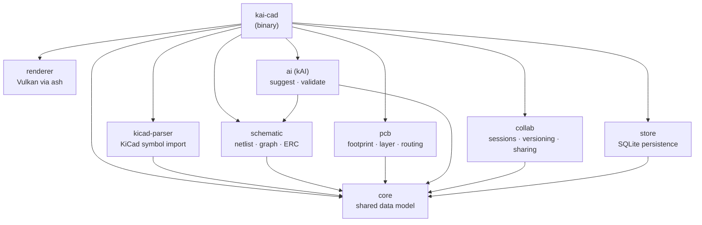
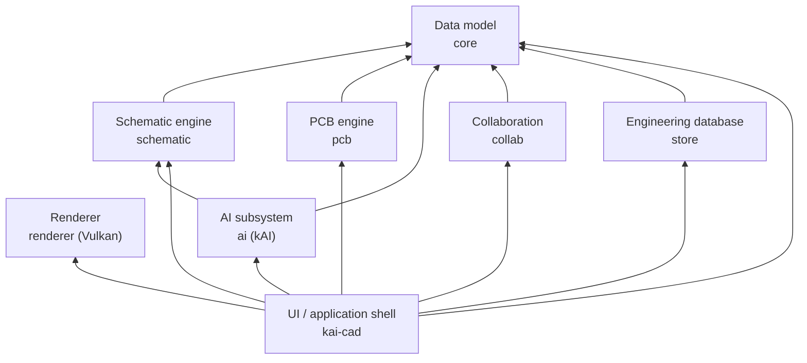

# KaiCad Architecture

> **Status: pre-alpha scaffold.** This document describes the intended
> architecture and the code that exists today. Most engines are type-level
> skeletons whose functions return `NotImplemented` or empty values. Do not
> read this as a description of working EDA functionality.
>
> Weeks 1 (workspace, core data model, CI), 2 (SQLite engineering database) and
> 3 (symbol libraries and KiCad `.kicad_sym` import) are complete. The workspace
> has 110 passing tests.

KaiCad is a Rust workspace containing a shared data model, per-domain engines,
a Vulkan renderer skeleton, an AI subsystem (`kAI`), a collaboration layer and
a thin application binary. The long-term goal is a complete EDA application
that is **not** a wrapper around KiCad (see `PRD.md`).

## Crate graph



Arrows mean "depends on". `core` sits at the bottom of the graph and must not
depend on any other workspace crate. There are no cross-engine edges between
`schematic` and `pcb`: both depend only on `core`. `renderer` has no workspace
dependencies at all (only `ash` and `serde`); it is wired into the application
binary, not into the data model.

## Application layering



The UI layer is currently only a CLI (`kai-cad/src/main.rs`): it prints a
banner, supports `--help`/`--version`, and runs a deterministic self-check that
calls every subsystem. A custom GUI is planned but not started. The AI and
collaboration layers are optional: KaiCad must remain usable without AI,
network access or external services (`PRD.md` §1.2, §1.3).

## Core data model

`core` is the single source of truth for design data. Dependencies: `serde`,
`serde_json`, `uuid`, `chrono`. No workspace dependencies.

| Module | Public types / functions | Purpose |
|--------|--------------------------|---------|
| `component` | `Component`, `ComponentProperty` | Instance linking a symbol to a footprint |
| `geometry` | `Point` | 2D point in millimetres with `distance_to` |
| `net` | `Net`, `NetClass` | Named connectivity and design-rule class |
| `pcb` | `PcbOutline`, `PcbLayer`, `LayerKind`, `Stackup` | Board outline, layers and layer order |
| `project` | `Project`, `SchematicData`, `PcbData`, `ProjectMetadata` | Root document and its sections |
| `proposal` | `ChangeProposal` | Field-level change shared by `ai` and `collab` |
| `serialization` | `Error`, `Result`, `to_json`, `to_json_pretty`, `from_json`, `save`, `load` | JSON encoding and file persistence |
| `sheet` | `Sheet`, `Wire`, `Label` and position/type enums | Hierarchical sheets, wires, labels |
| `symbol` | `Symbol`, `Pin` and direction/position/type enums | Schematic symbol and pins |
| `symbol_library` | `SymbolLibrary`, `SymbolLibrarySource` | Named, project-independent symbol collection and provenance |

All public types derive `serde::Serialize`/`Deserialize`.

### Serialization API

`core::serialization` provides generic helpers plus inherent methods on
`Project`:

```rust
use core::Project;
use core::serialization::{from_json, load, save, to_json, to_json_pretty};

let project = Project::new("demo");
let compact = to_json(&project)?;          // String
let pretty = to_json_pretty(&project)?;    // indented String
let decoded: Project = from_json(&pretty)?;
save(&project, "out/demo.json")?;          // creates parent directories
let loaded: Project = load("out/demo.json")?;

// Equivalent convenience methods:
let compact = project.to_json()?;
let decoded = Project::from_json(&compact)?;
project.save("out/demo.json")?;
let loaded = Project::load("out/demo.json")?;
```

`save` creates missing parent directories and writes pretty JSON. `Error`
distinguishes `Json` and `Io` failures and implements `std::error::Error`.

### Consolidation

The Week 1 cleanup removed the duplicated types that used to blur crate
boundaries:

- **One `Netlist`.** `schematic::netlist::Netlist` is the only definition;
  `schematic::lib.rs` re-exports it. `generate_netlist` and `Graph` both use it.
- **One `ChangeProposal`.** `core::ChangeProposal` is shared by `ai` and
  `collab` (`ai` re-exports it; `collab::sync` re-exports it) instead of each
  crate defining its own.
- **One set of PCB primitives.** `core::pcb::{PcbOutline, PcbLayer, Stackup}`
  and `core::Point` are used by `pcb::PcbDesign`, so the project document and
  the PCB engine speak the same types.
- **Versioning lives in `collab`.** The orphaned `pcb/src/versioning.rs` was
  deleted; `collab::VersioningManager` owns version history.
- **No copied modules.** `renderer` no longer contains a copy of the `collab`
  module and declares no workspace dependencies.

## What each crate owns

### `schematic` — schematic engine

Dependencies: `core`, `serde`, `uuid`. Modules:

- `netlist` — `Netlist`, `Connection`, `PinRef` and `generate_netlist`.
  `generate_netlist` indexes every symbol pin by `Pin::id`, walks each net's
  pins in order, and emits a `Connection` for every adjacent pair that resolves
  to a known pin. Unknown pin ids are skipped.
- `graph` — hand-rolled connectivity `Graph` of symbol/net `Node`s and `Edge`s.
  `Graph::from_netlist` builds one node per symbol and per net, and one edge per
  connection whose endpoints are known symbols; `node_count`/`edge_count`
  report the sizes.
- `erc` — `run_erc`, `ERCResult`, `Violation`, `ViolationSeverity`.

### `pcb` — PCB engine

Dependencies: `core`, `serde`, `uuid`. Modules:

- `footprint` — `Footprint`, `PadPosition`, `PadType`, `Outline`,
  `OutlineShape::{Rectangle, RoundedRectangle}`.
- `layer` — `LayerStack` (`new`, `push`, `len`, `is_empty`, `copper_layers`,
  `find`) over `core::PcbLayer`.
- `routing` — `Router`, `RoutingAlgorithm::{PushAndShove, LengthMatching,
  Hybrid}`, `RoutingOptimization`.
- `lib.rs` — `PcbDesign` (`outline`, `layers`, `stackup`, `footprints`,
  `tracks`, `vias`) built on `core::PcbOutline`/`core::PcbLayer`/
  `core::Stackup`/`core::Point`, plus `Track` and `Via`.

`PcbDesign::copper_layer_count` is implemented and honours the stackup. No
routing algorithm or board geometry computation exists yet.

### `renderer` — Vulkan rendering engine

Dependencies: `ash` (Vulkan bindings) and `serde` only. Modules: `window`,
`device`, `swapchain`, `render_pass`, `pipeline`.

- `RendererConfig { window: WindowConfig, vsync }`.
- `WindowConfig { title, width, height, resizable, fullscreen }` with
  `aspect_ratio()`.
- `Renderer::new()` and `Renderer::render()` return
  `Err(RendererError::NotImplemented)`; **no Vulkan objects are created yet.**

`ash` loads the Vulkan loader at runtime, so the workspace builds on machines
without a Vulkan SDK.

### `ai` — kAI subsystem

Dependencies: `core`, `schematic`, `serde`, `serde_json`, `uuid`. Modules:
`optimizer`, `suggester`, `validator`.

- `kAI`, `kAIConfig`, `kAIError` (the brand spelling is kept with
  `#[allow(non_camel_case_types)]`).
- `OptimizationContext { netlist: schematic::Netlist, current_design_hash,
  constraints }`.
- `SuggestionValidator::validate` implements the deterministic rules listed
  below.
- `kAI::suggest_optimization` still returns `NotImplemented`;
  `kAI::validate_suggestion` runs the validator locally (no network, no model).

The default endpoint is `http://localhost:11434` (a local model server).
Deterministic validation is mandatory and always on; `kAIConfig` exposes no
switch to disable it.

### `collab` — collaboration layer

Dependencies: `core`, `serde`, `serde_json`, `uuid`, `chrono`. Modules:
`versioning`, `sync`, `sharing`, `window`.

- `CollabManager::{new, create_session, session_count}`. `create_session` uses
  the passed `project_id` and seeds an `Owner` participant.
- `VersioningManager::{new, record, latest}`.
- `SharingManager::{share, unshare}`.
- `Window::new`.

No transport, merge algorithm or real-time sync exists yet.

### `store` — engineering database

Dependencies: `core`, `rusqlite` (with the `bundled` feature), `serde_json`,
`uuid`, `chrono`. Modules: `lib.rs` plus embedded `migrations/`.

- `Store` wraps a `rusqlite::Connection`, enables `PRAGMA foreign_keys = ON`,
  and applies migrations automatically on open.
- `Store::{open, open_in_memory}` create file-backed or in-memory databases.
- `Store::{create_project, load_project, list_projects, update_project,
  delete_project}` implement project CRUD.
- `Store::{create_symbol_library, load_symbol_library, list_symbol_libraries,
  update_symbol_library, delete_symbol_library}` implement symbol-library CRUD;
  listing is ordered by `name ASC`.
- `ProjectSummary` is returned by `list_projects` and ordered by
  `modified_at DESC, name ASC`.
- `StoreError` covers SQLite, JSON, I/O, `Duplicate` and migration failures.

**Schema rule:** the canonical record is `projects.document`, a complete JSON
serialization of `core::Project`. The tables `sheets`, `symbols`, `components`,
`nets` and `footprints` are queryable projections rebuilt from the document
inside the same transaction on every create/update. They must never be edited
independently of the authoritative document. Their primary key is
`(project_id, id)`: entity ids are unique within a project rather than
globally, so a duplicated project may reuse the same entity ids. Symbol
libraries use the same pattern in `symbol_libraries`: canonical `data` JSON with
queryable `name` and `source` projections. Migrations are numbered SQL files
embedded with `include_str!`; once applied they are immutable — add a new
numbered file rather than editing an old one.

### `kicad-parser` — KiCad symbol import

Dependencies: `core`, `uuid` (with the `v5` feature). The crate is import-only;
KiCad's file format never becomes the internal representation.

- `parse_symbol_library(path) -> Result<core::SymbolLibrary, ParseError>` reads
a `.kicad_sym` file and maps each top-level `(symbol ...)` to
  `core::Symbol`, including pins nested inside unit sub-symbols.
- `ParseError::{Io, Syntax, Unsupported}` implements `Display` and
  `std::error::Error`; malformed input never panics.
- The parser implements a minimal deterministic S-expression tokenizer/parser
  (atoms, quoted strings, nested lists). No generic expression crate is used.
- Library and symbol names become UUIDv5 ids with `Uuid::NAMESPACE_OID`, so
  parsing the same content twice yields identical ids. The library name is the
  file stem because KiCad libraries do not record one.
- Pins map name, number, electrical type, position (`at` x/y/angle in KiCad
  symbol space, no axis conversion) and direction derived from the electrical
  type. Known types include `free` and `no_connect`; only genuinely unknown
  types become `PinType::Unspecified`.

### `kai-cad` — application binary

Depends on every library crate. `src/main.rs` prints a banner, supports
`--help`/`--version`, and with no arguments runs a deterministic self-check:
it serializes a `Project`, generates and ERC-checks a netlist, builds a PCB
design, reads the default renderer, AI and collaboration configuration,
exercises the SQLite store with an in-memory database, and parses a hermetic
`.kicad_sym` fixture with `kicad-parser`. Integration tests live
in `kai-cad/tests/smoke.rs`; the workspace root is a virtual manifest, so a
root `tests/` directory would not be built.

## Data flow: schematic netlist to PCB

The intended pipeline (steps 2 and 3 have real implementations; the rest are
planned):

```mermaid
flowchart LR
    subgraph editing["Schematic editing (planned)"]
        sheets["Sheets<br/>wires · labels"]
        symbols["Symbols<br/>pins"]
    end

    netlist["schematic::Netlist<br/>nets · symbols · connections"]
    graph["schematic::Graph<br/>symbol/net nodes"]
    components["core::Component<br/>symbol_id ↔ footprint_id"]
    pcb["pcb::PcbDesign<br/>footprints · tracks · vias"]
    erc["ERC<br/>deterministic rules"]
    render["renderer<br/>(planned)"]

    sheets --> netlist
    symbols --> netlist
    netlist --> graph
    netlist --> components
    components --> pcb
    netlist --> erc
    pcb --> render
```

1. **Capture.** The user places symbols, wires and labels on sheets. These live
   in `Project.schematic` (`sheets`, `symbols`, `nets`).
2. **Netlist extraction.** `schematic::generate_netlist(&symbols, &nets)`
   produces a `Netlist` of nets and pin-to-pin `Connection`s. This is
   implemented: adjacent resolvable pins within each net become connections.
3. **Graph construction.** `Graph::from_netlist(&netlist)` builds the
   symbol/net connectivity graph. This is implemented.
4. **Symbol ↔ footprint binding.** Each `core::Component` references a
   `symbol_id` and a `footprint_id`, which is how schematic instances are
   matched to physical footprints. Binding logic is not written yet.
5. **Board construction.** The PCB engine takes the netlist plus footprint
   assignments and populates `PcbDesign` (`footprints`, `tracks`, `vias`).
   Tracks reference their net by `net_id`; vias record the layers they span.
   Only the data types exist today.
6. **Validation.** ERC runs on the schematic netlist with deterministic rules
   (see below). DRC on PCB geometry is planned.
7. **Cross-probing and rendering.** The renderer draws schematic/PCB data, and
   selections are intended to synchronise between views. Not implemented.

There is no code path yet that executes steps 4–7 end to end.

## Deterministic validation surfaces

### Electrical rule check (ERC)

`schematic::run_erc(&netlist)` is deterministic and independent of iteration
order. It reports:

| Rule id | Severity | Trigger |
|---------|----------|---------|
| `net-single-pin` | Warning | A net has fewer than two pins |
| `duplicate-net-name` | Error | Two nets share the same non-empty name |
| `self-connection` | Error | A connection's source and target pin are identical |

`ERCResult::valid` is true only when there are no `Error` or `Critical`
violations. `ERCResult::is_valid()` is the accessor.

### AI suggestion validation

`SuggestionValidator::validate(&suggestion, &constraints)` performs no network
access and no model invocation. It reports:

| Check | Field | Outcome |
|-------|-------|---------|
| `confidence_score` outside `0.0..=1.0` | `confidence_score` | Error |
| Empty `changes` list | `changes` | Error |
| `old_value == new_value` | `changes[<index>]` | Error (no-op) |
| Constraint with a negative `value` | constraint name | Warning |

`ValidationResult::valid` is true iff no errors were found.
`kAI::validate_suggestion` wraps this validator.

**AI output must pass these deterministic checks before it is applied to a
design.** This is a PRD requirement (`PRD.md` §1.3.12): kAI may propose
changes, but a human or downstream engine applies them only after validation.

## Key design rules

These come from `PRD.md` and `PLAN.md` and constrain every future change.

1. **No KiCad wrapping.** KaiCad implements its own engineering database,
   geometry engine, schematic engine, PCB engine, renderer and UI. KiCad 9/10
   file formats are used only as an import/export reference, never as the
   internal representation (`PRD.md` §1.1, `PLAN.md` §5.3).
2. **No mandatory cloud.** Projects are local-first. Collaboration, AI and
   network services are optional; the application must remain useful offline
   (`PRD.md` §1.2, §1.3.11).
3. **AI output must pass deterministic validation.** kAI may propose changes,
   but nothing is applied until `SuggestionValidator::validate` (and later
   ERC/DRC) accepts it (`PRD.md` §1.3.12, `ai/src/validator.rs`).
4. **Deterministic engineering operations.** No unseeded randomness in geometry,
   routing, netlisting or rule checks (`PLAN.md` §5.1).
5. **No silent data loss.** Unknown or unsupported data encountered on import
   must be preserved or reported, never dropped silently (`PRD.md` §1.3.10).
6. **Transactional editing.** Design mutations should be grouped into
   transactions that support undo/redo (`PRD.md` §1.3.7). Not implemented yet.
7. **GPU-accelerated rendering.** Vulkan is the target rendering API on all
   platforms (`PRD.md` §1.1).
8. **Modular, testable subsystems.** Each subsystem is a crate with a narrow
   public API; `core` owns shared types (`PLAN.md` §2.2).

## Compatibility targets

- **Primary:** KiCad 10 project files.
- **Secondary:** KiCad 9 project files.
- `kicad-parser` imports `.kicad_sym` symbol libraries. No `.kicad_sch` or
  `.kicad_pcb` parser or writer exists yet, and nothing is exported.

## Current milestone and next steps

**Complete (Weeks 1–3, starting from commit `c864fbb`):** workspace and crate
graph, shared `core` data model with JSON persistence, SQLite engineering
database (`store`, schema v3) with migrations plus project and symbol-library
CRUD, named symbol libraries and a deterministic `.kicad_sym` parser
(`kicad-parser`), deterministic netlist generation and three-rule ERC, PCB data
types and layer stack helper, renderer/AI/collab configuration types, `kai-cad`
self-check binary, CI, and documentation.

**Next (Week 4):** schematic engine. The planned work is:

1. Deterministic KiCad netlist export from `schematic::Netlist`.
2. Graph operations: neighbour lookup, connectivity tests and components.
3. Broader ERC: unconnected pins and duplicate symbol names.

The full work order is in [`NEXT_AGENT_PROMPT.md`](NEXT_AGENT_PROMPT.md).

The full work order is in [`NEXT_AGENT_PROMPT.md`](NEXT_AGENT_PROMPT.md).

## Licensing

GPL-3.0-or-later. See `README.md` and `docs/CONTRIBUTING.md` for the
contribution and header conventions.
