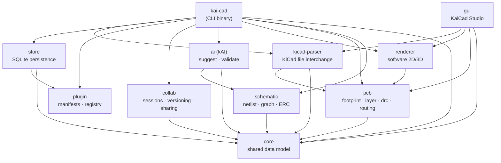
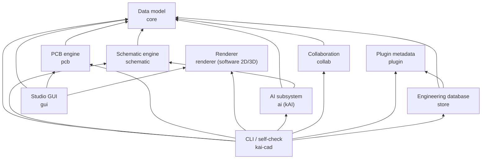

# KaiCad Architecture

> **Status: pre-alpha.** This document describes the intended architecture
> and the code that exists today. The data model, schematic and PCB engines,
> DRC, routing, software renderer, persistence, collaboration primitives and a
> desktop GUI editor/inspection shell are implemented and tested; full board and
> schematic editing, semantic KiCad project compatibility, the Vulkan GPU backend,
> AI generation and real-time transport remain incomplete. Do not read this as
> a description of a finished EDA application.
>
> Weeks 1 (workspace, core data model, CI), 2 (SQLite engineering database),
> 3 (symbol libraries and KiCad file interchange), 4 (schematic engine),
> 5 (PCB core), 6 (PCB geometry and DRC), 7 (deterministic single-layer
> routing), 8 (multi-layer routing with vias), 9 (transactional kAI
> application), 10 (collaborative edit sessions), 11 (multi-step edit
> history), 12 (plugin manifests and discovery), 13 (SQLite plugin registry),
> 14 (plugin activation and capability queries), 15 (plugin CLI) and the
> Phase 2 completion pass (rotated pads, blind/buried vias, push-and-shove,
> interactive routing and the software renderer) are complete. A post-Phase-2
> Studio shell adds native `.kicad_pcb` open/save, board viewing, inspection, DRC
> and click-to-route track editing, plus `.kicad_sch`/`.kicad_mod`/`.kicad_pro`
> file interchange, semantic zones/arcs/graphics/keepouts, library tables and
> shape-aware DRC. The P2 KiCad interoperability milestone is complete. The
> workspace has 389 passing tests.

KaiCad is a Rust workspace containing a shared data model, per-domain engines,
a deterministic software renderer, an AI subsystem (`kAI`), a collaboration
layer, a native desktop editor/inspection shell and a thin CLI binary. The long-term
goal is a complete EDA application
that is **not** a wrapper around KiCad (see `PRD.md`).

## Crate graph



Arrows mean "depends on". `core` sits at the bottom of the graph and must not
depend on any other workspace crate. There are no cross-engine edges between
`schematic` and `pcb`: both depend only on `core`. `renderer` depends on `pcb`
to rasterize a `PcbDesign`; it also keeps `ash` and `serde` for the Vulkan
configuration skeleton and uses `core` only in dev-dependencies. `gui` is a
leaf application crate that depends on `core`, `pcb`, `renderer` and
`kicad-parser`, plus the external `eframe`/`egui` window stack. It is not part
of the data model or the CLI binary.

## Application layering



The UI layer has two front ends. `kai-cad` is the CLI (`kai-cad/src/main.rs`):
it prints a banner, supports `--help`/`--version`, manages plugins, and runs a
deterministic self-check that calls every subsystem. `kai-cad-gui` is KaiCad
Studio (`gui/`): a native eframe window for board viewing, inspection, DRC and
2D track routing. Footprint/pad editing, schematic capture and pan/zoom remain
unimplemented.
The AI and collaboration layers are optional: KaiCad must remain usable without
AI, network access or external services (`PRD.md` §1.2, §1.3).

## Core data model

`core` is the single source of truth for design data. Dependencies: `serde`,
`serde_json`, `uuid`, `chrono`. No workspace dependencies.

| Module | Public types / functions | Purpose |
|--------|--------------------------|---------|
| `component` | `Component`, `ComponentProperty` | Instance linking a symbol to a footprint |
| `edit` | `EditTransaction`, `AppliedChange`, `EditError`, `apply`, `undo`, `redo` | Atomic field edits with stale-value checks and reversible transactions |
| `history` | `EditHistory`, `HistoryError` | Bounded undo/redo stacks with redo-branch clearing and capacity eviction |
| `geometry` | `Point`, `segment_distance` | 2D point in millimetres with `distance_to` and `distance_to_segment`; segment-to-segment distance |
| `net` | `Net`, `NetClass` | Named connectivity and design-rule class |
| `pcb` | `PcbOutline`, `BoundingBox`, `PcbLayer`, `LayerKind`, `Stackup` | Board outline with area/perimeter/contains-point/bounds, layers and layer order |
| `project` | `Project`, `SchematicData`, `PcbData`, `ProjectMetadata` | Root document and its sections |
| `proposal` | `ChangeProposal` | Field-level change shared by `ai` and `collab` |
| `serialization` | `Error`, `Result`, `to_json`, `to_json_pretty`, `from_json`, `save`, `load` | JSON encoding and file persistence |
| `sheet` | `Sheet`, `Wire`, `Label` and position/type enums | Hierarchical sheets, wires, labels |
| `symbol` | `Symbol`, `Pin` and direction/position/type enums | Schematic symbol and pins |
| `symbol_library` | `SymbolLibrary`, `SymbolLibrarySource` | Named, project-independent symbol collection and provenance |

All public types derive `serde::Serialize`/`Deserialize`.

### Serialization API

`core::serialization` provides generic helpers plus inherent methods on
`Project`:

```rust
use core::Project;
use core::serialization::{from_json, load, save, to_json, to_json_pretty};

let project = Project::new("demo");
let compact = to_json(&project)?;          // String
let pretty = to_json_pretty(&project)?;    // indented String
let decoded: Project = from_json(&pretty)?;
save(&project, "out/demo.json")?;          // creates parent directories
let loaded: Project = load("out/demo.json")?;

// Equivalent convenience methods:
let compact = project.to_json()?;
let decoded = Project::from_json(&compact)?;
project.save("out/demo.json")?;
let loaded = Project::load("out/demo.json")?;
```

`save` creates missing parent directories and writes pretty JSON. `Error`
distinguishes `Json` and `Io` failures and implements `std::error::Error`.

### Consolidation

The Week 1 cleanup removed the duplicated types that used to blur crate
boundaries:

- **One `Netlist`.** `schematic::netlist::Netlist` is the only definition;
  `schematic::lib.rs` re-exports it. `generate_netlist` and `Graph` both use it.
- **One `ChangeProposal`.** `core::ChangeProposal` is shared by `ai` and
  `collab` (`ai` re-exports it; `collab::sync` re-exports it) instead of each
  crate defining its own.
- **One set of PCB primitives.** `core::pcb::{PcbOutline, PcbLayer, Stackup}`
  and `core::Point` are used by `pcb::PcbDesign`, so the project document and
  the PCB engine speak the same types.
- **Versioning lives in `collab`.** The orphaned `pcb/src/versioning.rs` was
  deleted; `collab::VersioningManager` owns version history.
- **No copied modules.** `renderer` no longer contains a copy of the `collab`
  module; it depends only on `pcb` (and dev-only `core`) for board rendering.

## What each crate owns

### `schematic` — schematic engine

Dependencies: `core`, `serde`, `uuid`. Modules:

- `netlist` — `Netlist`, `Connection`, `PinRef`, `generate_netlist` and
  `to_kicad_netlist`. `generate_netlist` indexes every symbol pin by `Pin::id`,
  walks each net's pins in order, and emits a `Connection` for every adjacent
  pair that resolves to a known pin; unknown pin ids are skipped.
  `to_kicad_netlist` renders a deterministic, pretty-printed S-expression
  document: components and nets sorted, net codes from 1, nodes sorted by
  `(reference, pin, id)`, escaped strings and one trailing newline. It is
  export-only; no KiCad netlist is parsed back into the internal model.
- `graph` — hand-rolled connectivity `Graph` of symbol/net `Node`s and `Edge`s.
  `Graph::from_netlist` builds one node per symbol and per net, and one edge per
  connection whose endpoints are known symbols; `node_count`/`edge_count`
  report the sizes. `edges_for`, `neighbours`, `is_connected` (BFS) and
  `connected_components` add deterministic read-only traversal; unknown ids
  yield empty or `false` results rather than panics, and net nodes are isolated
  because edges only join symbol pins.
- `erc` — `run_erc`, `ERCResult`, `Violation`, `ViolationSeverity` and the five
  built-in rules listed below.

### `pcb` — PCB engine

Dependencies: `core`, `serde`, `serde_json`, `uuid`. Modules:

- `board` — `BoardZone`, `ZoneFill`, `ZoneKeepout`, `BoardArc`,
  `BoardGraphic`/`BoardGraphicKind`, arc sampling and polygon-distance helpers
  used by DRC and the KiCad parser.
- `footprint` — `Footprint` (with a board `position`), `PadPosition` (with
  copper `width`/`height`, counter-clockwise `rotation` in degrees and optional
  `net_id`), `PadType`, `PadShape` (rect, roundrect, oval, circle, trapezoid),
  `PadPosition::local_outline`, `Outline`,
  `OutlineShape::{Rectangle, RoundedRectangle}`, plus `FootprintLibrary`
  (`sorted`, `find`, `to_json`, `from_json`, `save`, `load`) and
  `FootprintLibraryError`. Missing placement and pad-size fields default, so
  older libraries still load. Libraries are KaiCad's own JSON with two-space
  indentation and one trailing newline; duplicate names are rejected on load.
  KiCad `.kicad_mod` read/write is a separate `kicad-parser` interchange path.
- `layer` — `LayerStack` (`new`, `push`, `len`, `is_empty`, `copper_layers`,
  `find`) over `core::PcbLayer`, plus `validate(&Stackup)` and
  `copper_layers_in_stackup(&Stackup)`. Validation reports `LayerIssue`s of
  kind `DuplicateId`, `DuplicateName`, `EmptyName`, `MissingFromStackup` and
  `NonCopperInStackup`, sorted by `(layer_id, kind)`.
- `drc` — `DrcRules` (validated, serde-friendly, stored on the design),
  `DrcRulesError`, `DrcSeverity`, `DrcViolation`, `DrcReport` and `run_drc`, a
  pure function implementing clearance, track, via, pad, pad-rotation,
  zone-fill and keepout rules plus rule-set validation. Via spans may be
  through, blind or buried as long as both endpoints are copper; same-layer
  and non-copper spans are errors.
- `routing` — `Router`, `RoutingAlgorithm::{PushAndShove, LengthMatching,
  Hybrid}`, `RoutingOptimization`, `RouterConfig` (grid, bend cost, expansion
  limit, `allow_vias`, via cost/limit/dimensions, `allow_blind_buried` and
  `max_shoved_tracks`), `RouteRequest`, `RouteError`, `RouteResult`,
  `route_multilayer`, `route_push_and_shove`, `PushAndShoveResult` and
  `InteractiveRouter`. A* state is `(node, layer, direction)` plus the via
  count; in-layer moves avoid tracks, vias and pads with the design's
  clearance, and a via transition stays on the node, costs `via_cost` and
  moves to another copper layer. Candidate vias must clear every spanned layer
  and satisfy `via-drill` and annular-ring limits; they are through vias by
  default and span only the layer change when `allow_blind_buried` is set.
  Tracks are split at layer changes and simplified per layer; ids are UUIDv5
  values over the request and segment. `route` disables via insertion and
  returns the tracks only. `route_push_and_shove` tries a bounded, id-sorted
  rip-up and reroute when a direct route returns `NoPath`. `InteractiveRouter`
  keeps a preview separate from the design until `commit`, with `cancel` and
  `preview_result` helpers. Same-net tracks and vias are traversable, so a
  route can start or T off existing copper; other nets remain obstacles.
- `lib.rs` — `PcbDesign` (`outline`, `layers`, `stackup`, `footprints`,
  `tracks`, `vias`, `zones`, `arcs`, `graphics`, `rules`) built on
  `core::PcbOutline`/`core::PcbLayer`/`core::Stackup`/`core::Point`, plus
  `Track` (copper `width`, default `0.25` mm), `Via` (optional `net_id`,
  `diameter`/`drill`, defaults `0.6`/`0.3` mm) and the semantic zone/arc/
  graphic types in `pcb::board`. Missing fields load with their defaults, so
  older documents still open.

`PcbDesign::copper_layer_count` is implemented and honours the stackup.
`copper_layer_ids` exposes stackup order and `net_ids` returns sorted, unique
assigned nets from tracks, vias and pads. Outline geometry lives on
`core::PcbOutline`: `signed_area`, `area`,
`perimeter`, `contains_point` (even-odd ray casting with boundary-inclusive
edges) and `bounding_box`. Design-rule checking lives in `pcb::drc`; single-
layer and multi-layer grid routing, push-and-shove and interactive sessions
live in `pcb::routing`. DRC uses each pad's rect/roundrect/oval/circle/
trapezoid outline; routing still treats pads as oriented rectangles.
`PcbDesign::via_kind` classifies through, blind and buried spans without
depending on start/end order.

### `renderer` — deterministic software renderer

Dependencies: `pcb`, `ash` and `serde`; `core` is a dev-dependency. Public
modules: `window`, `framebuffer`, `device`, `swapchain`, `render_pass`,
`pipeline`; `scene` is private rasterization code.

- `RendererConfig { window: WindowConfig, vsync, background }` and
  `WindowConfig { title, width, height, resizable, fullscreen }` with
  `aspect_ratio()`.
- `Color` is RGBA8. `Framebuffer` owns tightly packed RGBA rows, supports
  `pixel`/`clear` and writes binary PPM with `save_ppm`.
- `ViewMode::{TwoD, ThreeD}` selects the projection.
- `BoardView { center, zoom }` and `BoardTransform::for_view` add explicit 2D
  zoom and pan; `Renderer::render_pcb_view` renders that view, while
  `render_pcb` keeps the automatically fitted framing.
- `Renderer::new` allocates the framebuffer and depth buffer and rejects zero
  or oversized images. `render` clears the background; `render_pcb` and
  `render_pcb_with_camera` rasterize a `PcbDesign` synchronously.
- `Camera` stores eye/target/up, vertical field of view and near plane;
  `Camera::fit` frames the board automatically for 3D.

The 2D view fills the outline, draws copper in stackup order, rotated pad
copper and vias, then outlines the board. The 3D view extrudes the outline,
draws copper, pads and via prisms, projects them through the camera and uses
a depth buffer with flat shading. Output is deterministic for a given design,
camera and size. The renderer itself uses no window, GPU or Vulkan loader; the
Studio GUI presents the resulting texture in an eframe window.
`BoardTransform::for_board` exposes the same 2D fit as a board↔pixel mapping,
so viewport clicks and the rasterizer use identical coordinates. `BoardView`
stores the zoom and optional board centre; `BoardTransform::for_view` applies
them, keeping hit-testing and rasterization aligned at every zoom level.

The `ash`-based `device`, `swapchain`, `render_pass` and `pipeline` modules
remain configuration scaffolding for a future Vulkan backend; they are not
part of the software rendering path.

### `ai` — kAI subsystem

Dependencies: `core`, `schematic`, `serde`, `serde_json`, `uuid`. Modules:
`optimizer`, `suggester`, `validator`.

- `kAI`, `kAIConfig`, `kAIError` (the brand spelling is kept with
  `#[allow(non_camel_case_types)]`).
- `OptimizationContext { netlist: schematic::Netlist, current_design_hash,
  constraints }`.
- `SuggestionValidator::validate` implements the deterministic rules listed
  below.
- `kAI::validate_suggestion` runs the validator locally (no network, no model).
- `kAI::apply_suggestion` validates first, applies through `core::edit::apply`
  and returns `AppliedSuggestion { suggestion_id, transaction }`. Invalid or
  stale suggestions leave the project untouched; the transaction supports
  undo/redo.
- `kAI::suggest_optimization` still returns `NotImplemented`; suggestion
  generation and model calls are future work.

The default endpoint is `http://localhost:11434` (a local model server).
Deterministic validation is mandatory and always on; `kAIConfig` exposes no
switch to disable it.

### `collab` — collaboration layer

Dependencies: `core`, `serde`, `serde_json`, `uuid`, `chrono`. Modules:
`versioning`, `sync`, `sharing`, `window`.

- `CollabManager::{new, create_session, session_count, add_participant,
  set_role, can_edit, apply_edit}`. `create_session` seeds an `Owner`;
  `apply_edit` checks membership and role, applies a `core::edit` transaction,
  and bumps the session version only on success. `CollabError` covers unknown
  sessions/participants, duplicate participants, read-only viewers, edit
  failures and history failures.
- `VersioningManager::{new, record, record_transaction, latest,
  find_by_transaction}`. Transaction-linked entries store the transaction id
  and a UUIDv5 digest of the compact project JSON; legacy entries load with
  `None` fields.
- `SyncManager::{stage, drain, staged_count}` plus `pending_changes`; staging
  deduplicates by transaction id and draining preserves insertion order.
- `SharingManager::{share, unshare}` and `Window::new`.

No transport, merge algorithm or real-time sync exists yet.

### `store` — engineering database

Dependencies: `core`, `pcb`, `plugin`, `rusqlite` (with the `bundled` feature),
`serde_json`, `uuid`, `chrono`. Modules: `lib.rs` plus embedded `migrations/`.

- `Store` wraps a `rusqlite::Connection`, enables `PRAGMA foreign_keys = ON`,
  and applies migrations automatically on open.
- `Store::{open, open_in_memory}` create file-backed or in-memory databases.
- `Store::{create_project, load_project, list_projects, update_project,
  delete_project}` implement project CRUD.
- `Store::{create_symbol_library, load_symbol_library, list_symbol_libraries,
  update_symbol_library, delete_symbol_library}` implement symbol-library CRUD;
  listing is ordered by `name ASC`.
- `Store::{save_pcb_design, load_pcb_design, delete_pcb_design}` persist a
  complete `pcb::PcbDesign` (tracks, vias, footprints, pad copper and DRC
  rules) in `pcb_designs`, keyed by project. Saving is an upsert and requires
  the project to exist; deleting a project cascades to its design.
- `Store::{save_plugin, load_plugin, list_plugins, list_plugin_states,
  delete_plugin}` implement validated, id-sorted global plugin CRUD. Saving is
  an upsert that preserves activation state and validates before writing;
  loading validates the canonical manifest JSON again.
- `Store::{set_plugin_enabled, plugin_enabled, list_enabled_plugins,
  list_plugins_with_capability, list_enabled_plugins_with_capability}` manage
  activation and deterministic capability filters.
- `ProjectSummary` is returned by `list_projects` and ordered by
  `modified_at DESC, name ASC`.
- `StoreError` covers SQLite, JSON, I/O, `Duplicate`, `MissingProject`,
  `Plugin` and migration failures.

**Schema rule:** the canonical record is `projects.document`, a complete JSON
serialization of `core::Project`. The tables `sheets`, `symbols`, `components`,
`nets` and `footprints` are queryable projections rebuilt from the document
inside the same transaction on every create/update. They must never be edited
independently of the authoritative document. Their primary key is
`(project_id, id)`: entity ids are unique within a project rather than
globally, so a duplicated project may reuse the same entity ids. Symbol
libraries use the same pattern in `symbol_libraries`: canonical `data` JSON with
queryable `name` and `source` projections. PCB designs use `pcb_designs`, keyed
by `project_id` with the complete design JSON in `data`; they cascade with the
project. Plugins use the global `plugins` table: canonical `manifest` JSON with
queryable scalar/capability projections and a separate `enabled` flag that is
not part of the manifest. Migrations are numbered SQL files
embedded with `include_str!`; once applied they are immutable — add a new
numbered file rather than editing an old one.

### `kicad-parser` — KiCad file interchange

Dependencies: `core`, `pcb`, `serde_json`, `uuid` (with the `v5` feature).
KiCad's file format never becomes the internal representation.

- `parse_symbol_library(path) -> Result<core::SymbolLibrary, ParseError>` reads
a `.kicad_sym` file and maps each top-level `(symbol ...)` to
  `core::Symbol`, including pins nested inside unit sub-symbols.
- `parse_pcb(input) -> Result<PcbImport, ParseError>` and `load_pcb(path)` map
  supported `.kicad_pcb` content into `pcb::PcbDesign`; `PcbImport` carries the
  board and deterministic warnings.
- `parse_schematic`/`load_schematic` map components, wires, labels, junctions,
  no-connects and sheet symbols into `core::project::SchematicData`.
- `parse_footprint`/`load_footprint` map standalone `.kicad_mod` files into
  `pcb::Footprint`. `ProjectFile::{load, parse, save}` preserves `.kicad_pro`
  JSON and exposes parsed board DRC rules.
- `library_table::{parse, write}` handles `sym-lib-table` and `fp-lib-table`
  with entry order and unknown-node preservation. `ProjectBundle` recursively
  loads and rewrites the root and child schematics, the sibling board, both
  library tables and `${KIPRJMOD}` libraries, and applies project DRC rules.
- `write_pcb`, `write_schematic` and `write_footprint` (with file helpers) emit
  KiCad-openable documents. The CLI exposes `pcb|sch|footprint|project`
  import/export.
- Board conversion preserves the layer table and copper stackup, named nets,
  Edge.Cuts outlines, footprints/references/pad numbers, footprint rotation and
  side, standard pad shapes/copper outlines, tracks, vias, copper arcs, zones,
  keepouts and line/rectangle/circle/arc/polygon/text graphics. Custom pad
  primitives, dimensions, groups, models, setup/title data and unknown nodes
  are retained in `PcbDesign::source` or `Footprint::preserved` and re-emitted.
  DRC uses standard pad outlines and the modeled zone/arc geometry; routing
  still uses pad rectangles.
- Schematic conversion retains `lib_symbols`, property effects, pin blocks,
  instance paths, buses, text, images and unknown nodes. Child sheet symbols
  record their file name and placement.
- `ParseError::{Io, Syntax, Unsupported}` implements `Display` and
  `std::error::Error`; malformed input never panics.
- The parser implements a minimal deterministic S-expression tokenizer/parser
  (atoms, quoted strings, nested lists). No generic expression crate is used.
- Library and symbol names become UUIDv5 ids with `Uuid::NAMESPACE_OID`, so
  parsing the same content twice yields identical ids. PCB net ids use the net
  name, while track/via ids use KiCad's UUID when present.
- Pins map name, number, electrical type, position (`at` x/y/angle in KiCad
  symbol space, no axis conversion) and direction derived from the electrical
  type. Known types include `free` and `no_connect`; only genuinely unknown
  types become `PinType::Unspecified`.

### `plugin` — plugin metadata

Dependencies: `serde`, `serde_json` only. No workspace dependencies, and no
plugin code is loaded or executed.

- `PluginManifest { id, name, version, api_version, entry_point,
  capabilities }` with `PluginCapability::{Schematic, Pcb, Ai, ImportExport}`.
  `validate` enforces a lowercase ASCII id, non-empty name/version, API version
  `1`, at least one unique capability, and a relative entry point with no
  absolute prefix, drive prefix, backslash, `.`/`..` component or empty path
  component. It does not check whether the entry point exists.
- `PluginManifest::{from_json, to_json, save, load}` validate automatically;
  `save` writes pretty JSON with one trailing newline.
- `PluginRegistry::{register, remove, find, list, len, is_empty}` keeps
  manifests sorted by id, rejects duplicate or invalid manifests without
  mutating, and returns `list` in ascending id order.
- `discover_manifests` reads direct `*.json` regular files in file-name order,
  rejects duplicate ids and malformed files, and returns manifests sorted by
  `(id, entry_point)`. Missing directories and directories with no manifests
  return `PluginError::Io`.
- `PluginError::{InvalidManifest, UnsupportedApiVersion, DuplicateId,
  UnsafeEntryPoint, Json, Io}` implements `Display` and `std::error::Error`.
- Persistence and activation live in `store` (schema v6); the `plugin` crate
  remains metadata validation, ordering and local discovery only.

### `gui` — KaiCad Studio desktop shell

Dependencies: `core`, `pcb`, `renderer`, `kicad-parser`, `serde_json`, `uuid`,
and the external `eframe`/`egui` window stack. The crate has a library
(`kaicad_gui`) and the `kai-cad-gui` binary. Modules:

- `app` — `StudioState` is the headless application model. It owns the current
  `PcbDesign`, optional path, `ViewMode`, 2D `BoardView`, `DrcReport`,
  `TrackEditor`, active tool, dirty flag, status notice and a viewport revision.
  Zoom is clamped, panning is stored in board space, and opening or resetting a
  board restores the fitted view. It opens and saves
  `.kicad_pcb` natively through `kicad-parser` (JSON remains available), runs
  DRC, changes the view and forwards 2D clicks to the editor; failed operations
  leave the current board untouched. `StudioApp` is
  the `eframe::App` adapter. It draws a menu bar, a left document/routing/DRC
  inspector, a right layer-stack and footprint panel, a bottom status bar, and
  a central image. The image is a texture populated from `renderer::Renderer`
  output at a size capped by `MAX_VIEWPORT_SIDE` (2048 px). Renders are cached
  by size, view and design revision, so idle frames do not rasterize again.
- `editor` — `TrackEditor` owns route layer, net, width and router settings, a
  pending start point, and bounded undo/redo snapshots of the board. A click
  near a pad snaps to its centre and adopts its net. `route_to` runs the grid
  router on a candidate clone, rejects any candidate with more DRC findings
  than the current board, and only then commits it. `renderer::BoardTransform`
  converts the viewport click back to board millimetres.
- `demo` — deterministic two-layer demo board with five footprints, front and
  back tracks, and two through vias. It is DRC-clean under the default rules
  and renders in both views.
- `document` — format detection by extension: `.kicad_pcb` is loaded and saved
  through `kicad-parser`, while `.json` is an explicit interchange format.
  `LoadedBoard` carries the design and preservation warnings; unsupported
  extensions are rejected before I/O. Saving creates parent directories, and
  every I/O, JSON or KiCad failure is returned to the UI and shown in the status
  bar.

Input and shortcuts: `Ctrl+O` opens the path dialog, `Ctrl+S` saves to the
current path or opens Save As, `Ctrl+Z`/`Ctrl+Y` undo and redo track edits,
`R` toggles Inspect/Route, `F5` runs DRC, `Esc` cancels a pending route, and a
dropped file opens as a board. In 2D, the wheel zooms at the pointer,
middle-drag pans (primary-drag also pans in Inspect), `+`/`-` zoom and `0`
fits the board; the 3D view auto-fits. The shell offers a typed path rather
than a native file picker and has no footprint/pad/via editing or schematic
capture. The window uses eframe/glow for presentation but
the board image itself is still the deterministic CPU rasterizer; no Vulkan
code is involved.

### `kai-cad` — application binary

Depends on every library crate. `src/main.rs` prints a banner, supports
`--help`/`--version`, exposes `plugins list|show|enable|disable|discover` with
an optional `--db <path>` registry database, converts supported boards through
`pcb import|export`, and with no arguments runs a deterministic self-check: it
serializes a `Project`, generates, ERC-checks and exports a KiCad netlist,
builds a PCB design (outline measurements, layer validation, a footprint
library round trip, clean/dirty DRC runs, a DRC-clean single-layer route, a
multi-layer route across a full-width wall with through vias, a blocked-route
check, a push-and-shove reroute, an interactive preview/commit, and 2D/3D
software renders), applies a validated kAI suggestion and undoes/redoes it,
creates
a collaboration session with roles, records a versioned edit and stages/drains
its transaction, discovers and registers validated plugin manifests, exercises
the SQLite store with an in-memory database including plugin persistence and a
PCB-design round trip, parses a hermetic `.kicad_sym` fixture, and imports,
exports and re-imports PCB, schematic and footprint fixtures with
`kicad-parser`.
Integration tests live
in `kai-cad/tests/smoke.rs`; the workspace root is a virtual manifest, so a
root `tests/` directory would not be built.

## Data flow: schematic netlist to PCB

The intended pipeline (steps 2, 3, 5 (single- and multi-layer), 6 and 7
(persistence) have real implementations; the rest are planned):

```mermaid
flowchart LR
    subgraph editing["Schematic editing (planned)"]
        sheets["Sheets<br/>wires · labels"]
        symbols["Symbols<br/>pins"]
    end

    netlist["schematic::Netlist<br/>nets · symbols · connections"]
    graph["schematic::Graph<br/>symbol/net nodes"]
    components["core::Component<br/>symbol_id ↔ footprint_id"]
    pcb["pcb::PcbDesign<br/>footprints · tracks · vias"]
    erc["ERC<br/>deterministic rules"]
    render["renderer<br/>software 2D/3D"]

    sheets --> netlist
    symbols --> netlist
    netlist --> graph
    netlist --> components
    components --> pcb
    netlist --> erc
    pcb --> render
```

1. **Capture.** The user places symbols, wires and labels on sheets. These live
   in `Project.schematic` (`sheets`, `symbols`, `nets`).
2. **Netlist extraction.** `schematic::generate_netlist(&symbols, &nets)`
   produces a `Netlist` of nets and pin-to-pin `Connection`s. This is
   implemented: adjacent resolvable pins within each net become connections.
3. **Graph construction.** `Graph::from_netlist(&netlist)` builds the
   symbol/net connectivity graph. This is implemented.
4. **Symbol ↔ footprint binding.** Each `core::Component` references a
   `symbol_id` and a `footprint_id`, which is how schematic instances are
   matched to physical footprints. Binding logic is not written yet.
5. **Board construction.** The PCB engine takes the netlist plus footprint
   assignments and populates `PcbDesign` (`footprints`, `tracks`, `vias`).
   Tracks reference their net by `net_id`; vias record the layers they span and
   optionally their net. `route`, `route_multilayer`, `route_push_and_shove`
   and `InteractiveRouter` can add tracks and vias, but automatic
   symbol-to-footprint binding is still manual.
6. **Validation and storage.** ERC runs on the schematic netlist and DRC runs on
   the PCB geometry, both with deterministic rules (see below). `store` can
   save and reload the complete PCB design with its rules.
7. **Cross-probing and rendering.** The software renderer draws PCB data to a
   headless framebuffer, and the Studio GUI presents it in a native window.
   Schematic drawing, cross-probing between schematic and PCB, and view
   selection synchronization are not implemented.

There is no code path yet that executes steps 4–7 end to end from a netlist.

## Deterministic validation surfaces

### Electrical rule check (ERC)

`schematic::run_erc(&netlist)` is deterministic and independent of iteration
order. It reports:

| Rule id | Severity | Trigger |
|---------|----------|---------|
| `net-single-pin` | Warning | A net has fewer than two pins |
| `duplicate-net-name` | Error | Two nets share the same non-empty name |
| `self-connection` | Error | A connection's source and target pin are identical |
| `unconnected-pin` | Warning | A symbol pin appears in no net (one per pin) |
| `duplicate-symbol-name` | Error | Two symbols share the same non-empty name (one per name) |

`ERCResult::valid` is true only when there are no `Error` or `Critical`
violations. `ERCResult::is_valid()` is the accessor.

### Design-rule check (DRC)

`pcb::run_drc(&design, &rules)` is a pure, deterministic function. Violations
are sorted by `(rule_id, objects)`, each unordered copper pair on different nets
is reported once, and the report never depends on track order or `HashMap`
iteration.

| Rule id | Severity | Trigger |
|---------|----------|---------|
| `track-width` | Error for a non-finite or `<= 0` width, Warning below `min_track_width` | Track or copper-arc width |
| `track-layer` | Error | Track/arc layer missing or not copper |
| `clearance` | Error | Tracks, arcs, vias and pads on a shared copper layer with different nets are closer than `clearance`, edge to edge |
| `zone-clearance` | Error | A zone fill is closer than `clearance` to foreign copper |
| `zone-keepout` | Error | A track, arc, via, pad, footprint or copper fill enters a keepout area |
| `track-outside-board` | Error | A track or arc path point lies outside the outline |
| `via-outside-board` | Error | A via centre lies outside the outline |
| `pad-outside-board` | Error | A pad corner lies outside the outline |
| `pad-size` | Error | A pad width or height is non-finite or `<= 0` |
| `pad-rotation` | Error | A pad rotation is non-finite |
| `via-span` | Error | Via ends on the same layer or uses a missing/non-copper layer; through, blind and buried spans are valid |
| `via-drill` | Error for a non-finite or non-positive drill/diameter, drill `>=` diameter, or drill below `min_via_drill`; Warning for a ring below `min_annular_ring` | Via drill, diameter and annular ring |
| `track-path` | Error | A track has fewer than two points or a non-finite coordinate |
| `drc-rules` | Error | A stored limit is non-finite or `<= 0`; checks then run with the defaults |

An outline with fewer than three points disables the board-containment rules.
An empty stackup means layer order is unknown, so `via-span` only requires two
distinct, existing copper layers. Pad copper is a shape-aware outline centred
on `Footprint::position + PadPosition::{x, y}` and rotated counter-clockwise by
`PadPosition::rotation`; through-hole pads occupy every copper layer,
surface-mount and tented pads the top copper layer, and pads in the same
footprint are not compared with each other. Copper arcs are sampled as short
segments for width, layer, containment and clearance checks; zone fills and
keepout polygons use the same polygon-distance helpers.
Pad-to-track and track-to-via clearance is skipped when the shared net matches;
generated vias carry `Some(net_id)`, while older documents load `None` and are
compared as different nets. Limits live on
`PcbDesign::rules` and serialize with the design; `DrcRules` defaults to a
`0.15` mm minimum width, `0.2` mm clearance, `0.05` mm minimum annular ring
and `0.2` mm minimum via drill. `DrcRules::validate` rejects non-finite or
non-positive limits, and `run_drc` reports them through `drc-rules` without
silently changing a valid rule set. `DrcReport::is_valid` ignores warnings,
and `DrcReport::count` filters by severity. A non-finite distance from
`core::geometry` is never treated as clearance.

### AI suggestion validation

`SuggestionValidator::validate(&suggestion, &constraints)` performs no network
access and no model invocation. It reports:

| Check | Field | Outcome |
|-------|-------|---------|
| `confidence_score` outside `0.0..=1.0` | `confidence_score` | Error |
| Empty `changes` list | `changes` | Error |
| `old_value == new_value` | `changes[<index>]` | Error (no-op) |
| Constraint with a negative `value` | constraint name | Warning |

`ValidationResult::valid` is true iff no errors were found.
`kAI::validate_suggestion` wraps this validator.

**AI output must pass these deterministic checks before it is applied to a
design.** This is a PRD requirement (`PRD.md` §1.3.12): kAI may propose
changes, but a human or downstream engine applies them only after validation.

## Key design rules

These come from `PRD.md` and `PLAN.md` and constrain every future change.

1. **No KiCad wrapping.** KaiCad implements its own engineering database,
   geometry engine, schematic engine, PCB engine, renderer and UI. KiCad 9/10
   file formats are used only as an import/export reference, never as the
   internal representation (`PRD.md` §1.1, `PLAN.md` §5.3).
2. **No mandatory cloud.** Projects are local-first. Collaboration, AI and
   network services are optional; the application must remain useful offline
   (`PRD.md` §1.2, §1.3.11).
3. **AI output must pass deterministic validation.** kAI may propose changes,
   but nothing is applied until `SuggestionValidator::validate` (and later
   ERC/DRC) accepts it (`PRD.md` §1.3.12, `ai/src/validator.rs`).
4. **Deterministic engineering operations.** No unseeded randomness in geometry,
   routing, netlisting or rule checks (`PLAN.md` §5.1).
5. **No silent data loss.** Unknown or unsupported data encountered on import
   must be preserved or reported, never dropped silently (`PRD.md` §1.3.10).
6. **Transactional editing.** Design mutations are grouped into reversible
   `core::edit` transactions with stale-value checks (`PRD.md` §1.3.7).
   Collaborative sessions and version history build on these transactions, and
   `core::history::EditHistory` adds bounded multi-step undo/redo. Merge,
   history persistence and PCB-object edits are not implemented yet.
7. **GPU-accelerated rendering.** Vulkan is the target rendering API on all
   platforms (`PRD.md` §1.1).
8. **Modular, testable subsystems.** Each subsystem is a crate with a narrow
   public API; `core` owns shared types (`PLAN.md` §2.2).
9. **Plugin metadata is untrusted.** Manifests are validated before use,
   discovery is local and sorted, and entry points remain relative. No plugin
   code is loaded or executed.

## Compatibility targets

- **Primary:** KiCad 10 project files.
- **Secondary:** KiCad 9 project files.
- `kicad-parser` imports `.kicad_sym` symbol libraries and provides
  `.kicad_pcb`, `.kicad_sch`, `.kicad_mod` and `.kicad_pro` file interchange;
  `schematic` exports a KiCad netlist. Zones, keepouts, arcs, graphics, standard
  pad shapes and project DRC rules are semantically modeled; custom pad
  primitives, dimensions and some setup fields are preserved. `ProjectBundle`
  handles recursive project bundles, `sym-lib-table`/`fp-lib-table` and
  `${KIPRJMOD}` libraries. No KiCad netlist importer exists yet.

## Current milestone and next steps

**Complete (Weeks 1–15 and the Phase 2 PCB/renderer scope, starting from commit
`c864fbb`):** workspace and crate graph, shared `core` data model with JSON
persistence, SQLite engineering database (`store`, schema v6) with migrations
plus project, symbol-library, PCB-design and plugin CRUD, named symbol
libraries and a deterministic `.kicad_sym` parser (`kicad-parser`),
deterministic netlist generation and KiCad export, graph traversal, five-rule
ERC, board-outline geometry, layer-stack validation, JSON footprint
libraries, distance primitives, track/via dimensions, rotated pad copper,
track/via/pad DRC with validated limits, deterministic single-layer and
multi-layer grid routing with through, blind and buried vias, push-and-shove
rip-up/reroute, interactive routing previews, atomic core edit transactions
with validated kAI suggestion application and undo/redo, permission-checked
collaborative sessions with versioned project digests and staged transactions,
bounded multi-step undo/redo history with branch clearing, validated plugin
manifests with deterministic registry ordering, local discovery, SQLite
persistence, activation state, capability filters and CLI management, a
deterministic software 2D/3D renderer, the `kai-cad` self-check binary, a
post-Phase-2 Studio shell (`gui`) for board viewing, 2D zoom/pan, inspection,
DRC and undoable track routing, and `.kicad_pcb`/`.kicad_sch`/`.kicad_mod`/`.kicad_pro`
file interchange with semantic zones/arcs/graphics, library tables and opaque
preservation, a five-file corpus and a 19-project template validation pass, CI
(including a Markdown link check and coverage job), and documentation. The
workspace has **389 passing tests**.

**Next (Week 16):** foundation release hardening. The planned work is:

1. Harden the CLI parser and add user-facing plugin documentation.
2. Add performance baselines for serialization, routing and plugin CRUD.
3. Complete the release checklist and foundation-level compatibility audit.

The full work order is in [`NEXT_AGENT_PROMPT.md`](NEXT_AGENT_PROMPT.md). Full
KiCad parity is a separate, longer program; see
[`KICAD_PARITY.md`](KICAD_PARITY.md).

## Licensing

GPL-3.0-or-later. See `README.md` and `docs/CONTRIBUTING.md` for the
contribution and header conventions.
